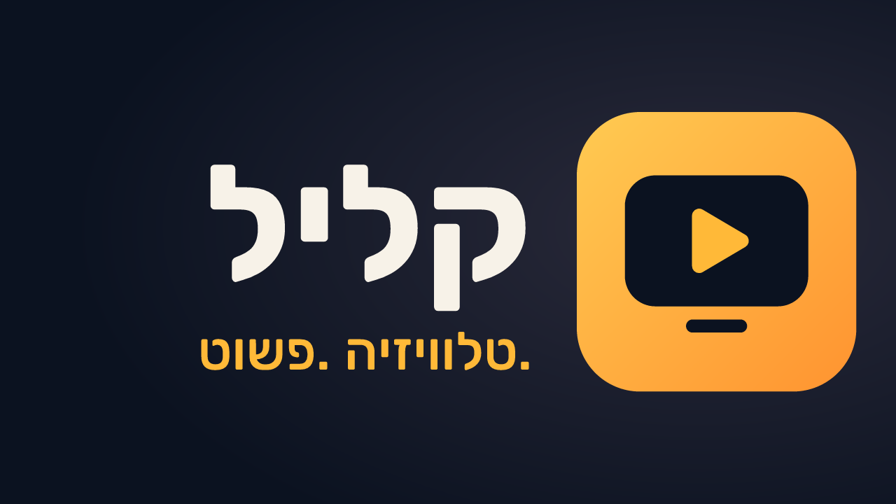

# קליל TV – טלוויזיה. פשוט.

נגן IPTV לאנדרואיד TV, שנבנה לכל המשפחה ובמיוחד למי שפחות מתחבר לטכנולוגיה.

## התקנה על הטלוויזיה (פעם אחת)

1. בטלוויזיה/בסטרימר: פתחו את חנות האפליקציות והתקינו את **Downloader** (של AFTVnews).
2. פתחו את Downloader והקלידו את הכתובת הקצרה:
   **`tinyurl.com/kalil-tv-app`**
   (או המלאה: `https://github.com/ofirgershon/kalil-tv-app/releases/latest/download/KalilTV.apk`)
3. אשרו "התקנה ממקורות לא ידועים" עבור Downloader כשתתבקשו, ולחצו **התקנה**.
4. פתחו את **קליל TV**, סרקו את הקוד עם הטלפון והדביקו את קישור המנוי. זהו.

## מה יש בפנים

- **חיבור מהטלפון בסריקת QR** – בלי להקליד קישורים ארוכים בשלט.
- **מדריך שידורים שמותאם לבד** – לפי מזהה הערוץ, ואם אין – לפי השם.
- **צפייה לאחור עד 7 ימים** ו"צפייה מההתחלה" בלחיצה אחת (כשהספק תומך).
- **הקלטות** – פרק אחד או "כל הפרקים" של סדרה. מסודרות לפי תוכנית ולפי מספר הפרק.
- **שומר על כרטיס הזיכרון** ועוצר עם הודעה ברורה כשהמקום נגמר.
- טקסט גדול, ניגודיות גבוהה וכפתורים גדולים. גודל הטקסט ניתן לשינוי.
- **שידור חלק** – הטלוויזיה שומרת מאגר קטן מהשידור, כך שתקיעות אצל הספק לא מורגשות.

## מה חדש בגרסה 1.3

- **ערוצים חינמיים וחוקיים בלחיצה**: כאן 11, רשת 13, עכשיו 14, כאן חינוכית, מכאן 33, ערוץ הכנסת, ערוץ 9, i24NEWS והידברות. כולם מהשידור הרשמי של גופי השידור, כמו בעידן+, וגם עם מדריך שידורים. אפשר להשתמש בהם גם בלי מנוי, ואפשר להוסיף רשימת M3U משלכם מהטלפון. בהגדרות ← "ערוצים חינמיים וחוקיים".
- **הספרייה שלי**: כל מה שהקלטתם או שמרתם מהשבוע האחרון מסודר לפי סדרות, סרטים ותוכניות. לכל אחד יש תמונה, ואפשר להמשיך לצפות מהמקום שבו עצרתם. פרקים שכבר ראיתם מסומנים ב-✓.
- **שידור חלק יותר**: כל ערוץ נטען 45 שניות מראש. בערוצים שהשרת שומר בהם את הדקות האחרונות, הן יורדות במהירות מלאה כבר בשנייה הראשונה.
- **שעון על המסך**: שעון קטן בפינה, ימין או שמאל לבחירתכם, או בלי שעון.
- **יציבות**: הנגן לא נתקע יותר כשזמני השידור קופצים. מצב "אין מקום" נעלם לבד אחרי שמתפנה מקום.

## מה חדש בגרסה 1.2.1

- **צפייה לאחור גם כשהספק לא מסמן אותה**: האפליקציה בודקת מול שרת הספק, כמו TiviMate ו-Televizo, ואם צריך פשוט מנסה.
- **שמירת תוכנית ששודרה**: במדריך השידורים לוחצים על תוכנית שכבר שודרה ובוחרים "שמירה בהקלטות שלי", והיא יורדת מהארכיון.
- **כל הפרקים של סדרה**: נשמרים גם הפרקים ששודרו בשבוע האחרון (עד 30 פרקים, בלי כפילויות), וגם הפרקים שישודרו בעתיד.
- **תוקנה הקריסה במדריך השידורים** בלחיצה על ימינה או שמאלה, ותוקנה תקיעה נוספת של הנגן.
- **דוח תקלות נשלח בקלות**: בהגדרות ← "דוח תקלות", סורקים את הקוד בטלפון, ונפתח דף עם כפתור "שליחה בוואטסאפ".

## מה חדש בגרסה 1.2

- **פס ערוצים כמו ב-yes+** – חץ למעלה/למטה פותח פס ערוצים בתחתית המסך עם לוגו, שם ומה משודר עכשיו. ◀ ▶ לדפדוף, OK לצפייה.
- **תפריט פעולות מהירות** – לחיצה על OK: הקלטה, הקלטת כל הסדרה, צפייה מההתחלה, פרטים, מועדפים, הערוץ הקודם ומקלדת מספרים.
- **התפריטים נסגרים לבד** אחרי 15 שניות בלי לחיצה.
- **הקלטה שעובדת בכל ערוץ** – גם בערוץ בלי מדריך שידורים (בוחרים כמה זמן), ובלי חיבור נוסף לספק כשמקליטים את הערוץ שצופים בו.
- **יציבות** – תוקנה תקיעה שגרמה לאפליקציה להיסגר, ונוסף "דוח תקלות" בהגדרות.

